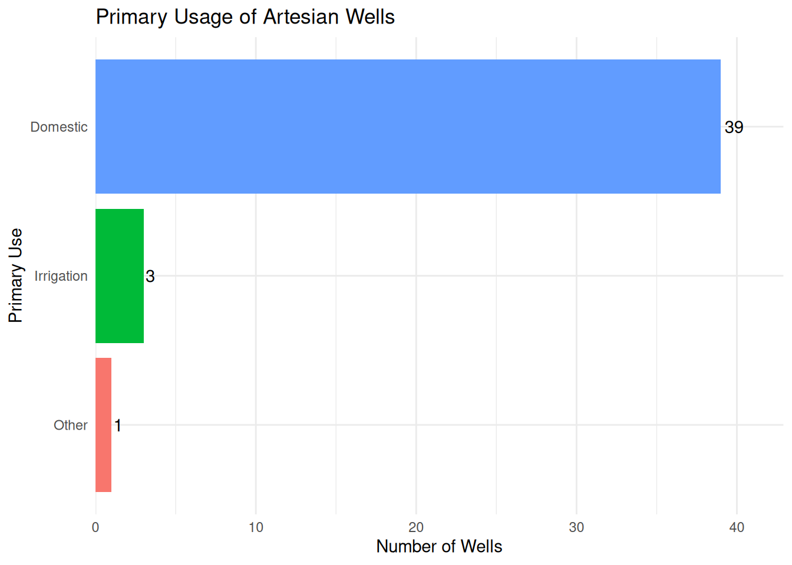

# Artesian Wells Image Gallery

## Introduction

This vignette provides a visual showcase of the artesian wells
documented in the dataset. The images are organized by district and
displayed alongside key information about each well site.

Show code

``` r

# Prepare data with image URLs
wells_with_images <- artesianwells %>%
  filter(!is.na(well_images)) %>%
  mutate(
    # Extract first image URL if multiple are separated by semicolons
    first_well_image = str_extract(well_images, "^[^;]+"),
    first_area_photo = if_else(!is.na(area_photos), 
                               str_extract(area_photos, "^[^;]+"), 
                               NA_character_)
  ) %>%
  select(
    district,
    traditional_authority,
    latitude,
    longitude,
    has_structure,
    well_structure_type,
    seconds_to_fill_20L,
    use_of_site,
    river_nearby,
    has_operator,
    mgmt_type,
    first_well_image,
    first_area_photo
  )

# Count wells by district
district_summary <- wells_with_images %>%
  group_by(district) %>%
  summarise(
    well_count = n(),
    avg_fill_time = round(mean(seconds_to_fill_20L, na.rm = TRUE), 1),
    .groups = "drop"
  ) %>%
  arrange(desc(well_count))
```

## Overview

The dataset contains images for **43** artesian well sites across **10**
districts in Malawi.

Show code

``` r

district_summary %>%
  gt() %>%
  cols_label(
    district = "District",
    well_count = "Number of Wells",
    avg_fill_time = "Avg. Fill Time (seconds)"
  ) %>%
  tab_header(
    title = "Artesian Wells Distribution",
    subtitle = "Wells with documented images"
  ) %>%
  fmt_number(
    columns = avg_fill_time,
    decimals = 1
  ) %>%
  tab_style(
    style = cell_fill(color = "lightblue"),
    locations = cells_body(columns = well_count, rows = well_count > 5)
  )
```

| Artesian Wells Distribution  |                 |                          |
|------------------------------|-----------------|--------------------------|
| Wells with documented images |                 |                          |
| District                     | Number of Wells | Avg. Fill Time (seconds) |
| Machinga                     | 10              | 62.9                     |
| Mangochi                     | 8               | 58.2                     |
| Blantyre                     | 5               | 104.9                    |
| Chikwawa                     | 4               | 17.8                     |
| Ntchisi                      | 4               | 38.8                     |
| Karonga                      | 3               | 37.2                     |
| Neno                         | 3               | 0.0                      |
| Salima                       | 3               | 18.6                     |
| Balaka                       | 2               | 153.7                    |
| Liwonde                      | 1               | 0.0                      |

Table 1: Summary of artesian wells by district

## Wells by District

### Machinga

| Artesian Wells in Machinga |  |  |  |  |  |  |
|:---|:---|---:|:---|:---|:---|:---|
| 10 well sites documented |  |  |  |  |  |  |
| Well Image | Traditional Authority | Coordinates | Structure | Fill Rate | Primary Use | Operator |
|  | Sitola | -15.1098, 35.2455 | Yes | Slow (\> 60s) | Domestic | NA |
|  | Sitola | -15.1133, 35.2368 | Yes | Slow (\> 60s) | Domestic | NA |
|  | Sitola | -15.0803, 35.2369 | Yes | Fast (\< 30s) | Domestic | NA |
|  | Sitola | -15.0813, 35.239 | Yes | Fast (\< 30s) | Domestic | NA |
|  | Sitola | -15.078, 35.2403 | Yes | Fast (\< 30s) | Domestic | NA |
|  | Sitola | -15.0787, 35.2427 | Yes | Fast (\< 30s) | Domestic | NA |
|  | Sitola | -15.0622, 35.2344 | Yes | Slow (\> 60s) | Domestic | Yes |
|  | Stola | -15.1141, 35.2379 | Yes | Fast (\< 30s) | Domestic | NA |
|  | Stola | -15.1141, 35.2379 | Yes | Fast (\< 30s) | Domestic | NA |
|  | Stola | -15.1026, 35.2337 | Yes | Slow (\> 60s) | Domestic | Yes |

### Mangochi

| Artesian Wells in Mangochi |  |  |  |  |  |  |
|:---|:---|---:|:---|:---|:---|:---|
| 8 well sites documented |  |  |  |  |  |  |
| Well Image | Traditional Authority | Coordinates | Structure | Fill Rate | Primary Use | Operator |
|  | Chimwala | -14.7534, 35.1993 | Yes | Slow (\> 60s) | Domestic | Yes |
|  | Chimwala | -14.7533, 35.1993 | Yes | Moderate (30-60s) | Domestic | Yes |
|  | Chimwala | -14.7234, 35.1723 | Yes | Slow (\> 60s) | Domestic | Yes |
|  | Chimwala | -14.7523, 35.202 | Yes | Fast (\< 30s) | Domestic | Yes |
|  | Chimwala | -14.4832, 35.2643 | Yes | Slow (\> 60s) | Domestic | Yes |
|  | Chimwala | -14.7341, 35.189 | Yes | Slow (\> 60s) | Domestic | Yes |
|  | Chimwala | -14.7358, 35.1906 | Yes | Fast (\< 30s) | Domestic | No |
|  | TA Chimwala | -14.7526, 35.2042 | Yes | Moderate (30-60s) | Domestic | Yes |

### Blantyre

| Artesian Wells in Blantyre |  |  |  |  |  |  |
|:---|:---|---:|:---|:---|:---|:---|
| 5 well sites documented |  |  |  |  |  |  |
| Well Image | Traditional Authority | Coordinates | Structure | Fill Rate | Primary Use | Operator |
|  | Machinjiri | -15.7578, 35.0025 | No | Fast (\< 30s) | Other | NA |
|  | TA Chigalu | -15.3765, 34.9852 | Yes | Fast (\< 30s) | Domestic | NA |
|  | TA Kapeni | -15.6469, 35.0212 | Yes | Slow (\> 60s) | Domestic | NA |
|  | TA Lundu | -15.4958, 35.1109 | Yes | Slow (\> 60s) | Domestic | NA |
|  | TA Somba | -15.9172, 34.9365 | Yes | Moderate (30-60s) | Domestic | No |

### Chikwawa

| Artesian Wells in Chikwawa |  |  |  |  |  |  |
|:---|:---|---:|:---|:---|:---|:---|
| 4 well sites documented |  |  |  |  |  |  |
| Well Image | Traditional Authority | Coordinates | Structure | Fill Rate | Primary Use | Operator |
|  | Mankhuwila | -16.2437, 35.0101 | Yes | Moderate (30-60s) | Domestic | Yes |
|  | Mgabu | -16.3001, 34.8412 | Yes | Fast (\< 30s) | Domestic | Yes |
|  | Mgabu | -15.8398, 34.3957 | Yes | Fast (\< 30s) | Domestic | Yes |
|  | TA Maseya | -16.0369, 34.9116 | Yes | Fast (\< 30s) | Domestic | NA |

### Ntchisi

| Artesian Wells in Ntchisi |  |  |  |  |  |  |
|:---|:---|---:|:---|:---|:---|:---|
| 4 well sites documented |  |  |  |  |  |  |
| Well Image | Traditional Authority | Coordinates | Structure | Fill Rate | Primary Use | Operator |
|  | Chikho | -13.4189, 34.058 | NA | Fast (\< 30s) | Domestic | NA |
|  | Kasakula | -13.3739, 34.0964 | Yes | Fast (\< 30s) | Irrigation | No |
|  | Kasakula | -13.3793, 34.0665 | Yes | Moderate (30-60s) | Domestic | Yes |
|  | Malenga | -13.3333, 33.8693 | Yes | Slow (\> 60s) | Domestic | Yes |

### Karonga

| Artesian Wells in Karonga |  |  |  |  |  |  |
|:---|:---|---:|:---|:---|:---|:---|
| 3 well sites documented |  |  |  |  |  |  |
| Well Image | Traditional Authority | Coordinates | Structure | Fill Rate | Primary Use | Operator |
|  | Kyungu | -10.1265, 34.0035 | Yes | Fast (\< 30s) | Domestic | Yes |
|  | Kyungu | -9.9465, 33.8672 | Yes | Moderate (30-60s) | Domestic | Yes |
|  | Mwilangombe | -10.3061, 34.1245 | Yes | Moderate (30-60s) | Domestic | NA |

### Neno

| Artesian Wells in Neno |  |  |  |  |  |  |
|:---|:---|---:|:---|:---|:---|:---|
| 3 well sites documented |  |  |  |  |  |  |
| Well Image | Traditional Authority | Coordinates | Structure | Fill Rate | Primary Use | Operator |
|  | Simon | -15.2908, 34.9987 | Yes | Fast (\< 30s) | Domestic | Yes |
|  | Simoni | -15.3235, 34.978 | Yes | Fast (\< 30s) | Domestic | Yes |
|  | Symon | -15.2908, 34.9986 | Yes | Fast (\< 30s) | Domestic | No |

### Salima

| Artesian Wells in Salima |  |  |  |  |  |  |
|:---|:---|---:|:---|:---|:---|:---|
| 3 well sites documented |  |  |  |  |  |  |
| Well Image | Traditional Authority | Coordinates | Structure | Fill Rate | Primary Use | Operator |
|  | Khombedza | -13.6473, 34.1564 | Yes | Moderate (30-60s) | Domestic | Yes |
|  | Maganga | -13.7322, 34.5687 | Yes | Fast (\< 30s) | Irrigation | No |
|  | Maganga | -13.733, 34.5687 | Yes | Fast (\< 30s) | Irrigation | No |

### Balaka

| Artesian Wells in Balaka |  |  |  |  |  |  |
|:---|:---|---:|:---|:---|:---|:---|
| 2 well sites documented |  |  |  |  |  |  |
| Well Image | Traditional Authority | Coordinates | Structure | Fill Rate | Primary Use | Operator |
|  | TA Nkaya | -15.2984, 35.0069 | Yes | Slow (\> 60s) | Domestic | NA |
|  | TA Nkaya | -15.2886, 35.0102 | Yes | Slow (\> 60s) | Domestic | NA |

### Liwonde

| Artesian Wells in Liwonde |  |  |  |  |  |  |
|:---|:---|---:|:---|:---|:---|:---|
| 1 well sites documented |  |  |  |  |  |  |
| Well Image | Traditional Authority | Coordinates | Structure | Fill Rate | Primary Use | Operator |
|  | Sitola | -15.1105, 35.2576 | Yes | Fast (\< 30s) | Domestic | Yes |

## Image Grid View

For a quick visual overview, here’s a grid displaying all well images
organized in rows of 4:


Balaka - TA Nkaya


Balaka - TA Nkaya


Blantyre - TA Chigalu


Blantyre - TA Lundu


Blantyre - TA Kapeni


Blantyre - TA Somba


Liwonde - Sitola


Machinga - Sitola


Chikwawa - TA Maseya


Machinga - Sitola


Machinga - Stola


Machinga - Stola


Machinga - Stola


Machinga - Sitola


Machinga - Sitola


Machinga - Sitola


Machinga - Sitola


Chikwawa - Mankhuwila


Machinga - Sitola


Karonga - Kyungu


Karonga - Mwilangombe


Ntchisi - Malenga


Ntchisi - Chikho


Ntchisi - Kasakula


Ntchisi - Kasakula


Salima - Maganga


Salima - Maganga


Salima - Khombedza


Blantyre - Machinjiri


Karonga - Kyungu


Chikwawa - Mgabu


Chikwawa - Mgabu


Mangochi - Chimwala


Mangochi - Chimwala


Mangochi - Chimwala


Mangochi - TA Chimwala


Mangochi - Chimwala


Mangochi - Chimwala


Neno - Symon


Neno - Simon

## Usage Patterns

Show code

``` r

wells_with_images %>%
  count(use_of_site) %>%
  mutate(use_of_site = fct_reorder(use_of_site, n)) %>%
  ggplot(aes(x = n, y = use_of_site, fill = use_of_site)) +
  geom_col() +
  geom_text(aes(label = n), hjust = -0.2) +
  scale_x_continuous(expand = expansion(mult = c(0, 0.1))) +
  labs(
    x = "Number of Wells",
    y = "Primary Use",
    title = "Primary Usage of Artesian Wells"
  ) +
  theme_minimal() +
  theme(legend.position = "none")
```



Figure 1: Distribution of artesian wells by primary use

## Flow Rate Analysis

Show code

``` r

wells_with_images %>%
  filter(!is.na(seconds_to_fill_20L)) %>%
  group_by(district) %>%
  summarise(
    n_tested = n(),
    min_time = min(seconds_to_fill_20L, na.rm = TRUE),
    avg_time = mean(seconds_to_fill_20L, na.rm = TRUE),
    max_time = max(seconds_to_fill_20L, na.rm = TRUE),
    .groups = "drop"
  ) %>%
  gt() %>%
  cols_label(
    district = "District",
    n_tested = "Wells Tested",
    min_time = "Min (s)",
    avg_time = "Average (s)",
    max_time = "Max (s)"
  ) %>%
  fmt_number(
    columns = c(min_time, avg_time, max_time),
    decimals = 1
  ) %>%
  tab_header(
    title = "Flow Rate Statistics",
    subtitle = "Time to fill 20-liter container"
  ) %>%
  data_color(
    columns = avg_time,
    colors = scales::col_numeric(
      palette = c("green", "yellow", "red"),
      domain = NULL
    )
  )
```

| Flow Rate Statistics            |              |         |             |         |
|---------------------------------|--------------|---------|-------------|---------|
| Time to fill 20-liter container |              |         |             |         |
| District                        | Wells Tested | Min (s) | Average (s) | Max (s) |
| Balaka                          | 2            | 64.1    | 153.7       | 243.3   |
| Blantyre                        | 5            | 0.0     | 104.9       | 361.4   |
| Chikwawa                        | 4            | 0.0     | 17.8        | 41.4    |
| Karonga                         | 3            | 24.6    | 37.2        | 46.7    |
| Liwonde                         | 1            | 0.0     | 0.0         | 0.0     |
| Machinga                        | 10           | 0.0     | 62.9        | 221.3   |
| Mangochi                        | 8            | 0.0     | 58.2        | 140.5   |
| Neno                            | 3            | 0.0     | 0.0         | 0.0     |
| Ntchisi                         | 4            | 0.0     | 38.8        | 96.5    |
| Salima                          | 3            | 0.0     | 18.6        | 37.5    |

Table 2: Flow rate statistics by district

## Data Notes

- Images are hosted on the mwater API and may require internet
  connection to display
- Some wells have multiple images; only the first image is displayed in
  this gallery
- Flow rate data is not available for all wells
- The dataset was collected in April 2024
